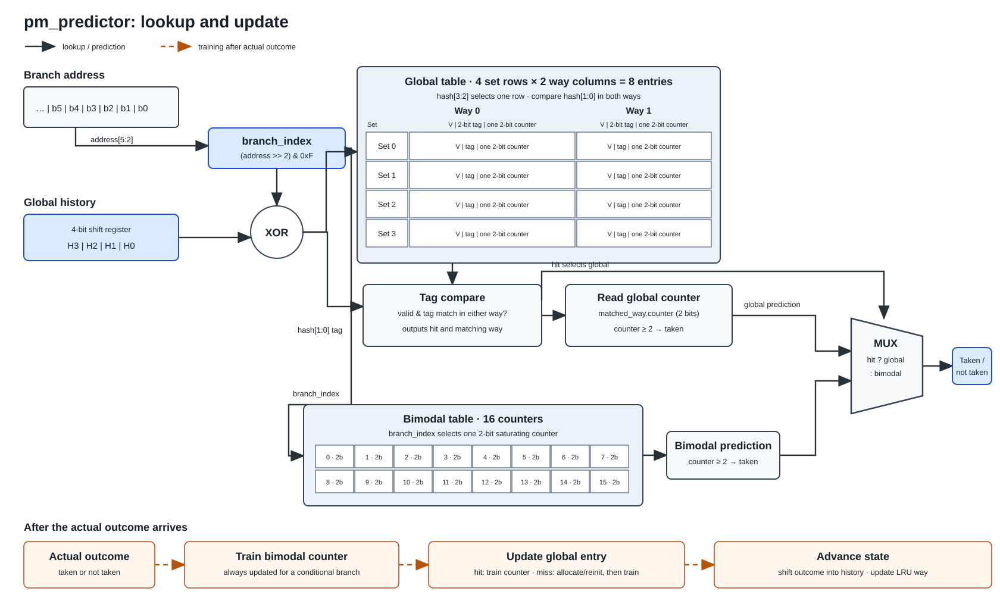

# Branch Predictor Report

## What Changed

Implemented `pm_predictor` for standard direction prediction and `cpm_predictor` for extra-credit direction-plus-target prediction in `src/my_predictor.h`.

## How the Predictor Works

`pm_predictor` combines a **bimodal table** with a **global-history table**. The global table has four set rows and two way columns; each set/way entry contains a valid bit, a tag, and one 2-bit counter. The organization matches Appendix B: each way has one entry per set row. The diagram shows the lookup and update paths.

### Predictor structure



### Prediction

For each conditional branch, `predict()` forms a bimodal index from the address and a global set/tag from the XOR of that index with the four-bit history:

```cpp
unsigned int branch_index = (b.address >> 2) & (BIMODAL_SIZE - 1);
unsigned int global_index = branch_index ^ history;
u.bimodal_index = branch_index;
u.global_set = global_index >> 2;
u.global_tag = global_index & 3;
```

The upper two XOR bits select a set row, and the lower two bits are compared with the tags in both ways of that row. A valid tag match supplies the global prediction; if neither way matches, the bimodal prediction is used:

```cpp
u.global_hit = false;
for (unsigned int way = 0; way < GLOBAL_WAYS; way++) {
    global_entry &entry = global[u.global_set][way];
    if (entry.valid && entry.tag == u.global_tag) {
        u.global_way = way;
        u.global_hit = true;
        u.direction_prediction (entry.counter >= 2);
        break;
    }
}
if (!u.global_hit)
    u.direction_prediction (bimodal[u.bimodal_index] >= 2);
```

For example, address `0x28` gives `branch_index = 1010`. With history `0110`, the XOR is `1100`, which selects set 3 and tag 0. If Way 1 in set 3 is valid with tag 0 and counter 2, the global prediction is taken. If neither way matches and bimodal counter 10 is 1, the fallback prediction is not taken.

Both tables use two-bit saturating counters with values 0–3: values 0 and 1 predict not taken; 2 and 3 predict taken. A nonconditional branch retains the default taken direction and is not updated. The predictor sets target prediction to zero because it predicts direction, not target addresses.

### Component update and replacement

`update()` uses the set, tag, and hit/way information saved during the lookup. It first trains the bimodal counter. For the global table, a hit trains the counter in the matching entry. A miss uses an invalid way if available; when both ways are valid, it replaces the way stored in `lru_way[set]`:

```cpp
unsigned int way = state->global_way;
if (!state->global_hit) {
    if (!global[state->global_set][0].valid)
        way = 0;
    else if (!global[state->global_set][1].valid)
        way = 1;
    else
        way = lru_way[state->global_set];

    global_entry &entry = global[state->global_set][way];
    entry.valid = true;
    entry.tag = state->global_tag;
    entry.counter = 1;
}
train_counter(global[state->global_set][way].counter, taken);
lru_way[state->global_set] = 1 - way;
history = ((history << 1) | (taken ? 1U : 0U)) & ((1U << HISTORY_BITS) - 1);
```

The selected way is the only global entry changed on a full-set miss: its old tag and counter are discarded, the new tag is installed, and its counter is initialized to 1 before training. The other way's entry remains unchanged. `lru_way` stores the next victim candidate. For example, after an access to Way 0, `lru_way[set]` becomes 1; if that set is full, its next miss replaces Way 1. If a way is invalid, the code fills that way instead of evicting a valid entry.

Counter training moves one step toward the actual outcome and saturates at 0 and 3:

```cpp
if (taken) {
    if (counter < 3) counter++;
} else if (counter > 0) {
    counter--;
}
```

Thus, `1 + taken` becomes 2, `2 + not taken` becomes 1, `3 + taken` stays 3, and `0 + not taken` stays 0. Each new global entry starts at counter 1.

#### Update example: global hit

With address `0x28` and history `0110`, suppose set 3, Way 1 has valid tag 0 and counter 2; bimodal counter 10 is 1. The global counter predicts taken. If the actual outcome is not taken, the bimodal counter changes from 1 to 0 and the matched global counter changes from 2 to 1. Way 0 remains unchanged. `lru_way[3]` becomes 0, and history changes from `0110` to `1100`.

#### Update example: global miss in a full set

Use the same address and history, with no tag-0 match in set 3, both ways valid, `lru_way[3] = 1`, and bimodal counter 10 equal to 1. The bimodal predictor predicts not taken. If the actual outcome is taken, the bimodal counter changes from 1 to 2. Way 1 is the LRU victim: its old entry is replaced with valid tag 0, its counter is initialized to 1, then trained to 2. Way 0 remains unchanged. The next victim candidate becomes Way 0, and history changes from `0110` to `1101`.

The 16-counter and four-set sizes are from the handout's simplified example, not a claim about the full Pentium M hardware. Such small tables can conflict frequently when processing real benchmark traces.

### Extra-credit predictor: `cpm_predictor`

`cpm_predictor` reuses `pm_predictor` for branch direction and adds a direct-mapped branch-target table with 4,096 entries. Each target entry stores a valid bit, the full branch address, and the last observed target. The address bits select a slot; comparing the full address detects whether that slot belongs to the current branch.

```cpp
direction_update = (pm_update *) direction.predict(b);
u.direction_prediction(direction_update->direction_prediction());

u.target_index = (b.address >> 2) & (TARGET_SIZE - 1);
u.branch_address = b.address;
u.target_prediction(0);
if (targets[u.target_index].valid &&
    targets[u.target_index].address == b.address)
    u.target_prediction(targets[u.target_index].target);
```

On a target-table hit, the saved target is predicted. On a miss or index collision, the prediction defaults to 0. After the branch executes, the direction component is trained and the target slot is replaced with the actual address/target pair:

```cpp
cpm_update *state = (cpm_update *) u;
direction.update(direction_update, taken, target);

target_entry &entry = targets[state->target_index];
entry.valid = true;
entry.address = state->branch_address;
entry.target = target;
```

For example, if branches at `0x100` and `0x4100` map to the same 4,096-entry slot, the full-address check prevents one branch from using the other's target. The later update replaces the slot, so the other branch will miss the next time it is looked up. Run the extra-credit executable on an individual trace with `./src/predict_extra_credit <trace-file>`; it reports direction and target MPKI.

## Run

From the project root, build the program and run it on all traces:

```sh
make -C src
./run traces
```

The script prints one score per benchmark and then the average. MPKI means mispredictions per 1,000 instructions:

```text
MPKI = mispredictions / instructions x 1,000
```

Each trace represents 100 million instructions. The direction results below use direction mispredictions; the extra-credit results use target mispredictions. Both averages are arithmetic averages across the 20 traces.

## Results

| Benchmark | MPKI |
|---|---:|
| `164.gzip` | 49.048 |
| `175.vpr` | 41.013 |
| `176.gcc` | 61.452 |
| `181.mcf` | 43.021 |
| `186.crafty` | 40.183 |
| `197.parser` | 39.578 |
| `201.compress` | 26.436 |
| `202.jess` | 47.546 |
| `205.raytrace` | 12.720 |
| `209.db` | 32.381 |
| `213.javac` | 13.179 |
| `222.mpegaudio` | 12.840 |
| `227.mtrt` | 13.149 |
| `228.jack` | 43.291 |
| `252.eon` | 22.841 |
| `253.perlbmk` | 58.460 |
| `254.gap` | 46.520 |
| `255.vortex` | 42.319 |
| `256.bzip2` | 88.448 |
| `300.twolf` | 45.254 |

These results are from the handbook-matching design with one 2-bit counter per global entry. The average across all 20 traces was **38.983 MPKI**. `205.raytrace` had the lowest score at **12.720 MPKI** and `256.bzip2` the highest at **88.448 MPKI**.

### Extra-credit target prediction results

The extra-credit driver uses the same `pm_predictor` direction component, so its direction MPKI matches the table above. Run `./run_extra traces` from the project root to collect the target-prediction results. This script runs `predict_extra_credit` once per trace and reports target mispredictions per 1,000 instructions:

| Benchmark | Target MPKI |
|---|---:|
| `164.gzip` | 151.146 |
| `175.vpr` | 128.272 |
| `176.gcc` | 170.832 |
| `181.mcf` | 217.004 |
| `186.crafty` | 89.270 |
| `197.parser` | 141.907 |
| `201.compress` | 117.649 |
| `202.jess` | 141.541 |
| `205.raytrace` | 122.019 |
| `209.db` | 131.918 |
| `213.javac` | 129.866 |
| `222.mpegaudio` | 130.212 |
| `227.mtrt` | 125.127 |
| `228.jack` | 119.263 |
| `252.eon` | 77.250 |
| `253.perlbmk` | 135.371 |
| `254.gap` | 138.380 |
| `255.vortex` | 110.738 |
| `256.bzip2` | 245.863 |
| `300.twolf` | 130.989 |

The average target MPKI was **137.730**; `252.eon` had the lowest target MPKI at **77.250**, while `256.bzip2` had the highest at **245.863**.

### Interpreting the results

Direction prediction answers **“Will this conditional branch be taken?”** Target prediction answers **“What address will it branch to?”** These are separate predictions: a branch can have the correct direction but the wrong destination, or the wrong direction but a correct destination. For example, predicting “taken” correctly but predicting `0x200` instead of the actual target `0x240` is a target error, not a direction error.

Both MPKI values are errors per 1,000 instructions, not percentages, and they count different things. In this project, the extra-credit driver compares the predicted target with the trace target on every conditional branch record, including not-taken branches. Therefore, the **137.730 target MPKI should not be read as a direction score or compared directly with 38.983 direction MPKI**. The target table is direct-mapped and predicts address 0 on a miss, so cold misses and slot conflicts can contribute target errors.

Across these traces, `256.bzip2` has the highest MPKI in both tables (88.448 direction, 245.863 target), while the lowest scores differ: `205.raytrace` for direction (12.720) and `252.eon` for target (77.250). This indicates that the traces stress direction and target prediction differently; the figures do not, by themselves, compare PM against another direction predictor.
